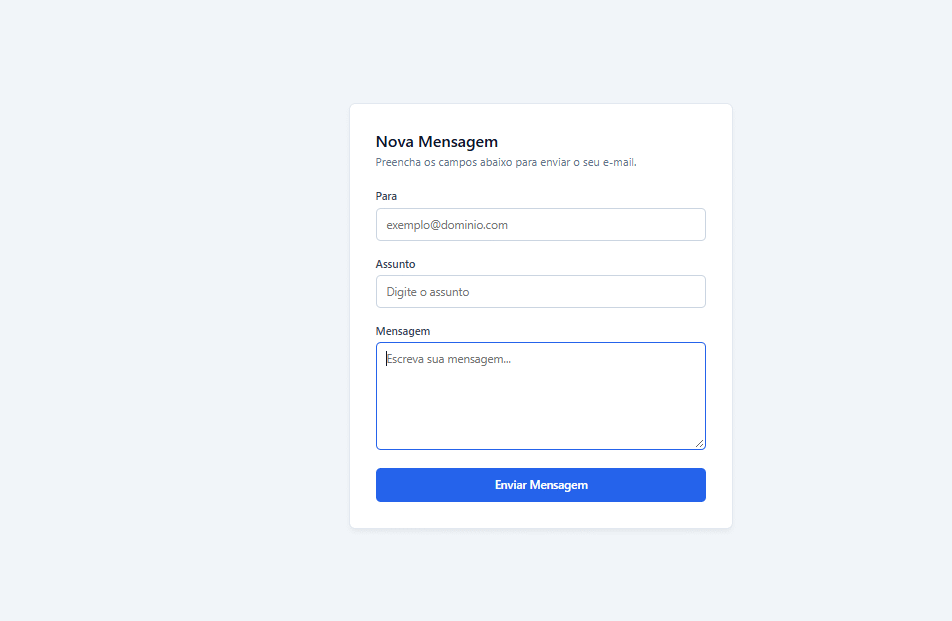
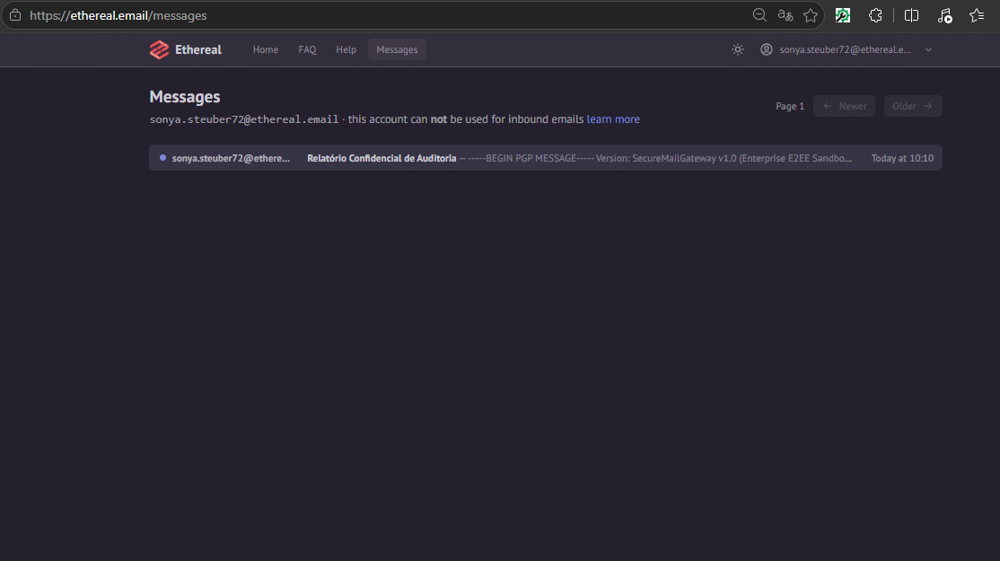

# Secure Mail Gateway 

API própria, construída em Python com FastAPI, focada em **Cibersegurança**, **Arquitetura Defensiva** e **Criptografia de Ponta a Ponta (E2EE)** para o envio e processamento seguro de e-mails corporativos.

Projeto de estudo/portfólio, desenvolvido para evoluir de um formulário simples para um gateway resiliente, utilizando o ambiente **sandbox** do Ethereal Email (sem disparo de e-mails reais para a internet).

## Sumário

- [Funcionalidades](#funcionalidades)
- [Tecnologias](#tecnologias)
- [Como rodar o projeto](#como-rodar-o-projeto)
- [Endpoints](#endpoints)
- [Demonstração](#demonstração)
- [Licença](#licença)
- [Aviso de segurança](#aviso-de-segurança)

## Funcionalidades

- Transmissão segura de e-mails via protocolo SMTPS (TLS)
- Validação estrita de entradas com Pydantic v2 contra ataques de Phishing
- Proteção contra *Email Header Injection* com expressões regulares
- Criptografia E2EE (PGP Armor) de mensagens antes do transporte
- Ocultação de detalhes internos de exceção (*Error Masking*) para evitar vazamento de dados
- Camada de fallback automática para execução local no Windows (sem depender de binários nativos do GnuPG)
- Interface web corporativa sanitizada contra Cross-Site Scripting (XSS)

## Tecnologias

- Python 3.10+
- FastAPI & Uvicorn
- Pydantic v2 & Pydantic Settings
- GnuPG / OpenPGP (`python-gnupg`)
- Ethereal Email (Ambiente SMTP Sandbox)
- Pytest & HTTPX (Testes automatizados)
- HTML5, CSS3 e JavaScript (Vanilla)

## Como rodar o projeto

git clone [https://github.com/noahsvieira/Gateway-de-Email-Seguro-.git](https://github.com/noahsvieira/Gateway-de-Email-Seguro-.git)
cd gateway-email-seguro
python -m venv .venv
.venv\Scripts\activate
pip install -r requisitos.txt 

## Endpoints

| Método | Rota | Descrição |
|---|---|---|
| GET | `/` | Servidor web estático da interface corporativa |
| POST | `/api/v1/enviar-email` | Criptografa o conteúdo em PGP e realiza o envio via SMTPS |
| GET | `/docs` | Documentação interativa Swagger/OpenAPI |

## Demonstração

### Interface

### Recebimento da mensagem

## Licença

Este projeto está sob a licença MIT — sinta-se à vontade para usar como referência de estudo.

## Aviso de segurança

Este projeto usa o ambiente sandbox do Asaas, sem movimentação de dinheiro real. Chaves de API e tokens são carregados via variáveis de ambiente (`.env`, não incluído no repositório) e nunca ficam expostos no código-fonte.